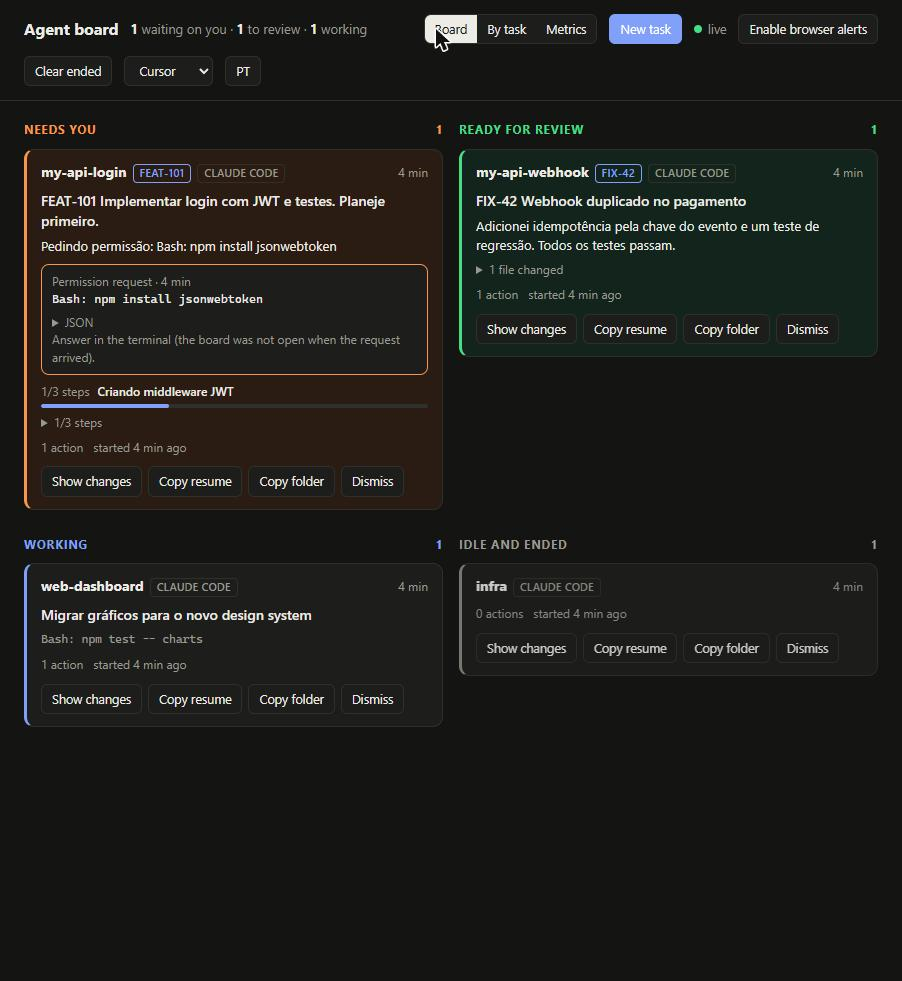

# Agent Board

**A local dashboard for running several Claude Code and Cursor agents in parallel without babysitting each session.**

Instead of switching into every terminal to check on your agents, each agent reports its state to the board through hooks. You only open a session when its card says it needs you or that it's ready for review.



- **Approve or deny permission requests from the board**, without switching terminals
- Per-card progress (the agent's todo list), tokens, estimated cost and **context window usage**
- Review on the card: diff vs. the base branch, file-by-file patches, open in Cursor/VS Code, PR + CI status, one-click draft PR
- **Start new agents** from the board, each in its own git worktree
- Group cards **by task ID** (`FEAT-123`) and see **metrics**: time working, time agents waited on you, cost per task
- Interface in Portuguese or English (toggle in the header)
- Zero dependencies: Node.js 18+ only
- Works on Windows, macOS and Linux
- Supports Claude Code and Cursor side by side
- Everything stays on your machine

> The board's interface is in Brazilian Portuguese. This guide gives each label in English with the on-screen text in parentheses.

---

## Contents

1. [How it works](#how-it-works)
2. [Requirements](#requirements)
3. [Installation](#installation)
4. [Verify it works](#verify-it-works)
5. [Daily workflow](#daily-workflow)
6. [Reading the board](#reading-the-board)
7. [Notifications](#notifications)
8. [Using it with Cursor](#using-it-with-cursor)
9. [Configuration](#configuration)
10. [Keeping the board running](#keeping-the-board-running)
11. [Troubleshooting](#troubleshooting)
12. [Uninstalling](#uninstalling)
13. [Privacy and security](#privacy-and-security)
14. [Project structure](#project-structure)

---

## How it works

```
Claude Code / Cursor ──hook event (JSON on stdin)──▶ hook.js ──writes──▶ ~/.agent-board/sessions/<id>.json
                                                                                  │ file watch
Browser (http://localhost:9999) ◀──────── live updates (SSE) ──────── server.js ◀─┘
```

1. **`hook.js`** runs on agent events: session start, prompt sent, tool used, waiting for you, turn finished, session ended. It records the session's state in a small JSON file.
2. **`server.js`** watches that folder and pushes changes to the browser in real time.
3. **The board** shows one card per session, sorted into columns by state.

The hook never blocks your agent. Any error is ignored and it exits in under 2 seconds.

---

## Requirements

| Requirement | How to check |
| --- | --- |
| Node.js 18 or newer | `node --version` |
| Claude Code and/or Cursor | `claude --version` / Cursor's About dialog |
| Git (optional, for branch names on cards) | `git --version` |

---

## Installation

### 1. Put the project in a permanent folder

The hooks point to the folder's absolute path, so choose a place you won't move it from.

```bash
# macOS / Linux
mkdir -p ~/tools && cd ~/tools
unzip ~/Downloads/agent-board.zip
cd agent-board
```

```powershell
# Windows (PowerShell)
mkdir $HOME\tools -Force; cd $HOME\tools
Expand-Archive $HOME\Downloads\agent-board.zip -DestinationPath .
cd agent-board
```

> If you move the folder later, run the install command again.

### 2. Install the hooks

**Claude Code:**

```bash
npm run install-hooks
```

This adds the board's hooks to `~/.claude/settings.json`. It:

- backs up your current file to `settings.json.bak-agent-board`
- keeps every hook you already have
- is safe to run more than once, so you never get duplicates

**Cursor:** see [Using it with Cursor](#using-it-with-cursor).

### 3. Restart your agent sessions

Claude Code loads hooks when a session starts. **Close and reopen** any session that was already running, or start new ones.

### 4. Start the board

```bash
npm start
```

Open **http://localhost:9999**.

---

## Verify it works

### Step 1: check the board with sample data

With the board running, open a second terminal in the project folder:

```bash
npm run demo
```

Four sample cards should appear immediately, one in each state. This runs the real `hook.js`, so it also confirms the hook works on your machine.

Remove them with:

```bash
npm run demo -- --clear
```

### Step 2: check a real session

1. Open a new Claude Code session in any project.
2. Send a prompt.
3. Within a second, a card with that folder's name appears under **Working** (*Trabalhando*).
4. When the agent finishes, the card moves to **Ready for review** (*Pronto para revisar*).

If nothing appears, see [Troubleshooting](#troubleshooting).

---

## Daily workflow

The board works best when each agent has its own isolated workspace and a clear task.

### 1. One worktree per task

Give each agent its own git worktree so parallel agents never edit the same files.

```bash
cd ~/work/my-api
git worktree add ../my-api-login -b feat/login
git worktree add ../my-api-webhook -b fix/duplicate-webhook
```

Each worktree folder becomes its own card, labeled with the folder name and branch.

### 2. Start one agent per worktree

```bash
cd ../my-api-login && claude
```

Make the **first prompt** a clear task description. The board uses the first prompt as the card's title.

> Good: `Implement JWT login with tests. Plan first and wait for my approval.`
> Less useful: `hi`

### 3. Work from the board, not the terminals

Keep the board open on a second monitor or a pinned tab and do your own work, such as code reviews or meetings. The browser tab title shows how many agents are waiting, for example `(3) Painel de agentes`.

| When a card is in… | Do this |
| --- | --- |
| **Needs you** (*Precisa de você*) | Read the message, click **Copy resume** (*Copiar retomada*), paste it into a terminal, answer the agent |
| **Ready for review** (*Pronto para revisar*) | Read the agent's summary, check the changed files, review the diff and open the PR |
| **Working** (*Trabalhando*) | Nothing. Leave it alone |
| **Working** with **Stuck?** (*Travou?*) | Open the session and check what's happening |

### 4. Handle the oldest first

In the two action columns, the card that has waited longest is always on top.

### 5. Clean up

- **Dismiss** (*Dispensar*) removes a card you're done with (it is archived for metrics, not deleted). If that session sends another event, the card comes back.
- **Clear ended** (*Limpar encerradas*) removes every closed session at once.
- Remove finished worktrees with `git worktree remove ../my-api-login`.

---

## Reading the board

### Columns

| Column | On screen | A card moves here when… |
| --- | --- | --- |
| Needs you | *Precisa de você* | The agent asked for permission or is waiting on a question |
| Ready for review | *Pronto para revisar* | The agent finished its turn |
| Working | *Trabalhando* | You sent a prompt or the agent is using tools |
| Idle and ended | *Ociosas e encerradas* | A session opened without a prompt yet, or was closed |

### What's on a card

| Element | Meaning |
| --- | --- |
| Folder name | The project or worktree the agent is running in |
| Badge | Which tool: **Claude Code** or **Cursor** |
| Time (`4s`, `12 min`) | Time since the last event from this session |
| Branch | Current git branch, when the folder is a repository |
| Bold title | The session's first prompt, which is the task |
| Message | Needs you: what the agent is asking. Ready for review: the agent's last reply |
| Monospace line | Working: the agent's latest action, such as `Bash: npm test` |
| **Stuck?** (*Travou?*) | No activity for 10 minutes while working |
| Files changed (*arquivos alterados*) | Click to expand the list of files the agent edited |
| Actions and age (*ações · iniciada há*) | Tool calls so far and when the session started |

### Buttons

| Button | On screen | What it does |
| --- | --- | --- |
| Copy resume | *Copiar retomada* | Copies `cd "<folder>" && claude --resume <session-id>` to reopen that exact session |
| Copy open in Cursor | *Copiar abrir no Cursor* | Copies `cursor "<folder>"` |
| Copy folder | *Copiar pasta* | Copies the folder path |
| Dismiss | *Dispensar* | Removes the card |

---

## Acting from the board

### Approving permission requests

When an agent asks for permission (for example to run `npm install`), its card shows the exact command with **Allow** / **Deny** buttons and an optional reason the agent reads when denied.

- This uses Claude Code's `PermissionRequest` hook. The hook waits for your answer **only while the board is open in a browser tab**. If the board is closed, it returns immediately and the terminal asks as usual.
- It waits up to `AGENT_BOARD_APPROVAL_WAIT` seconds (default 120). After that, the card says *answer in the terminal*.
- If you answer in the terminal instead, the card updates on its own.
- A hook "allow" never overrides a deny rule in your Claude Code settings.

> Whether Claude Code shows its terminal prompt *while* the hook is waiting is not documented. If you find the terminal blocked while you're at it, lower the wait (`AGENT_BOARD_APPROVAL_WAIT=30`) or set it to `0` to turn board approvals off.

Cursor has no equivalent event, so Cursor cards don't get approval buttons.

### Progress, tokens and context

- **Progress** comes from the agent's own task list (`TodoWrite`, or `TaskCreate`/`TaskUpdate` on newer versions). Some models don't use a task list by default, so not every card shows it.
- **Tokens, cost and context %** are read incrementally from the session transcript. Cost is an *estimate* at API list prices (see `lib/pricing.js`). On a subscription plan, read it as "how heavy was this session", not as a bill.
- The context bar turns amber at 80%. The card also shows compactions, running subagents, the permission mode (`plan`, `auto`, `bypassPermissions` in red), and the auto-generated session title.

### Reviewing work

Click **Show changes** (*Ver mudanças*) on a card:

- `+added −removed` against the branch's merge base with `origin/HEAD` (or `main`/`master`), including uncommitted work and new files
- click a file for its patch, or ↗ to open it in Cursor/VS Code (choose the editor in the header)
- PR number, state, review decision and CI checks (✓ ✗ ●) via the GitHub CLI (`gh`, logged in)
- **Create draft PR** pushes the branch and runs `gh pr create --fill --draft`. It refuses to run from `main`, `master`, `develop` or `production*`.

### Starting agents

**New task** (*Nova tarefa*): pick a repository (recent folders are suggested), a branch, and the first prompt.

- With *Create a new worktree*, it runs `git worktree add ../<repo>-<branch> -b <branch>` and opens a terminal there running `claude "<prompt>"`. It uses Windows Terminal when available, otherwise PowerShell; Terminal.app on macOS; `x-terminal-emulator` on Linux.
- Choosing Cursor opens the folder in Cursor instead.

### Tasks and checkpoints

- A task ID such as `FEAT-123` is read from the branch name first, then from the first prompt (uppercase only, so `step-2` isn't mistaken for one). Override the pattern with `AGENT_BOARD_TASK_RE`.
- **By task** (*Por tarefa*) groups Claude and Cursor sessions working on the same task.
- If an agent writes a file whose name contains `checkpoint`, the card shows *checkpoint saved*.

### Metrics

**Metrics** (*Métricas*) covers the last 1/7/30/90 days: time agents waited on you (asking + ready for review), time working, median response to asks, estimated cost, a per-day chart, and a per-task table.

Metrics come from `~/.agent-board/events.jsonl`, so they start counting from this version. A single open interval counts for at most 8 hours, so a card left overnight doesn't dominate.

## Notifications

### Browser notifications

Click **Enable browser alerts** (*Ativar avisos do navegador*) in the header and allow notifications. You'll get a desktop notification every time a card moves to *Needs you* or *Ready for review*, as long as the board tab is open.

### Phone push notifications (optional)

The board can send a push through [ntfy](https://ntfy.sh), a free service with no account needed.

1. Install the **ntfy** app on your phone.
2. Subscribe to a topic name that is hard to guess, for example `agent-board-k39fx2q7`. Anyone who knows the name can read the topic.
3. Set the variable in the environment where you launch your agents:

   ```bash
   # macOS / Linux: add to ~/.zshrc or ~/.bashrc
   export AGENT_BOARD_NTFY=https://ntfy.sh/agent-board-k39fx2q7
   ```

   ```powershell
   # Windows: then open a new terminal
   setx AGENT_BOARD_NTFY "https://ntfy.sh/agent-board-k39fx2q7"
   ```

4. Restart your agent sessions.

The push contains only the folder name, branch and state. It never includes code, prompts or messages.

---

## Using it with Cursor

```bash
npm run install-cursor
```

This writes the hooks to `~/.cursor/hooks.json`, with the same backup and the same protection for your existing hooks. **Restart Cursor** afterwards.

Cursor sessions show up on the same board with a **Cursor** badge. Because Cursor's hooks are different from Claude Code's, three things behave differently:

| Behavior | Claude Code | Cursor |
| --- | --- | --- |
| *Needs you* column | Yes, when the agent waits for approval | No: Cursor has no "waiting for approval" event. A blocked agent shows **Stuck?** after 10 minutes |
| Resume button | Reopens the exact session | Opens the project folder in Cursor |
| Last message | Read from the session transcript | Taken from the agent's last response |

To use **Copy open in Cursor**, install Cursor's shell command first: Command Palette → *Install 'cursor' command*.

> **Avoid duplicates:** Cursor can also load Claude Code's hooks. If you see the same Cursor conversation twice, turn off third-party hooks in Cursor or keep only `install-cursor`.

---

## Configuration

Set these as environment variables. Set them where you launch the board for `PORT`, and where you launch your agents for `NTFY`. Set `DIR` in both places.

| Variable | Default | Purpose |
| --- | --- | --- |
| `AGENT_BOARD_PORT` | `9999` | Port the board listens on |
| `AGENT_BOARD_DIR` | `~/.agent-board/sessions` | Folder where session states are stored |
| `AGENT_BOARD_NTFY` | not set | ntfy topic URL for phone push notifications |
| `AGENT_BOARD_APPROVAL_WAIT` | `120` | Seconds a permission request waits for the board (`0` = off). Re-run `npm run install-hooks` after changing it |
| `AGENT_BOARD_TASK_RE` | `FEAT-123` style | Regex for task IDs, e.g. `\b(PROJ-\d+)\b` |

You can also put these in a `.env` file in the project folder (Node 20.12+). Real environment variables take priority.

Example: run on another port.

```bash
AGENT_BOARD_PORT=8080 npm start
```

---

## Keeping the board running

The hooks keep recording even when the board is closed. When you start it again, every session's current state is there.

To keep it always on, either:

- leave it running in a dedicated terminal tab, or
- use a process manager such as [pm2](https://pm2.keymetrics.io/):

  ```bash
  npm install -g pm2
  pm2 start server.js --name agent-board
  pm2 save
  pm2 startup   # follow the printed instructions to start on boot
  ```

---

## Troubleshooting

### No card appears for a real session

1. **Restart the session.** Hooks are loaded when a session starts.
2. **Check the hooks were installed.** Inside Claude Code, run `/hooks`. You should see `node ".../agent-board/hook.js"` under events such as `Stop` and `UserPromptSubmit`. You can also open `~/.claude/settings.json`.
3. **Check state files are being written.** List the folder `~/.agent-board/sessions`. You should see one `.json` file per session.
4. **Run the hook by hand** from the project folder:

   ```bash
   echo '{"session_id":"test-1","cwd":"/tmp","hook_event_name":"UserPromptSubmit","prompt":"manual test"}' | node hook.js
   ```

   A "tmp" card should appear. Remove it with **Dismiss**.
5. **Did you move the project folder?** Run `npm run install-hooks` again.

### The board says "reconnecting…" (*reconectando…*)

The server stopped. Run `npm start` again. The page reconnects on its own.

### `EADDRINUSE` when starting

Port 9999 is in use. Start on another port: `AGENT_BOARD_PORT=8080 npm start`.

### A card is stuck in the wrong column

A session that crashed may never send its final event. Click **Dismiss**. The next event from that session recreates the card with the correct state.

### Branch is missing on cards

The folder isn't a git repository, Git isn't installed, or HEAD is detached.

### "Copy resume" doesn't copy

Some browsers block clipboard access. The board then shows the command in a dialog so you can copy it manually.

### Installer says "invalid JSON"

Your `settings.json` or `hooks.json` has a syntax error. Fix it, or restore the `.bak-agent-board` backup, then run the install again.

---

## Uninstalling

```bash
npm run uninstall-hooks     # Claude Code
npm run uninstall-cursor    # Cursor
```

Only the board's hooks are removed; your other hooks stay. Then delete the project folder and, optionally, the state folder `~/.agent-board`.

---

## Privacy and security

- The server listens on **127.0.0.1 only**, so other devices on your network can't open it.
- It checks the `Host` header (blocking DNS-rebinding attacks), and every write request needs an `X-Agent-Board` header plus a local `Origin`. A website open in your browser can't approve tool calls, start agents or open PRs through it.
- *Create draft PR* pushes to GitHub; nothing else on the board talks to the network (besides `gh pr view` for status).
- State files contain folder paths, a shortened first and last prompt, the agent's last message, and edited file names. They stay in `~/.agent-board/sessions` on your machine.
- Nothing is sent anywhere unless you set `AGENT_BOARD_NTFY`, and then only the folder, branch and state.
- Before using it at work, check that your company allows the AI tools themselves. The board adds no new data flow beyond your machine.

---

## Project structure

```
agent-board/
├── hook.js           # Receives agent events, writes session state, waits for approvals
├── server.js         # Local web server with live updates and the board's API
├── install.js        # Adds/removes hooks for Claude Code or Cursor
├── demo.js           # Creates sample cards to verify the setup
├── lib/
│   ├── state.js      # Session state machine (pure, unit-tested)
│   ├── store.js      # File locations, atomic writes, event log
│   ├── transcript.js # Incremental token/cost/context reader
│   ├── pricing.js    # Price and context window per model
│   ├── git.js        # Diff, PR status, draft PR
│   ├── launch.js     # New task: worktree + terminal
│   ├── metrics.js    # Time per state, waiting on you, cost per task
│   └── env.js        # Optional .env loading
├── public/
│   └── index.html    # The board UI
├── test/             # node --test
└── package.json
```

### Commands

| Command | What it does |
| --- | --- |
| `npm start` | Start the board at http://localhost:9999 |
| `npm run demo` | Create four sample cards |
| `npm run demo -- --clear` | Remove the sample cards |
| `npm test` | Run the tests |
| `npm run install-hooks` | Install hooks for Claude Code |
| `npm run uninstall-hooks` | Remove hooks from Claude Code |
| `npm run install-cursor` | Install hooks for Cursor |
| `npm run uninstall-cursor` | Remove hooks from Cursor |

---

## Roadmap

- Answering free-text questions from the board (today only permission requests can be answered)
- Phone approvals through ntfy action buttons (needs the board reachable from the phone)
- Linking a card to a ticket, and renaming cards

## License

MIT
