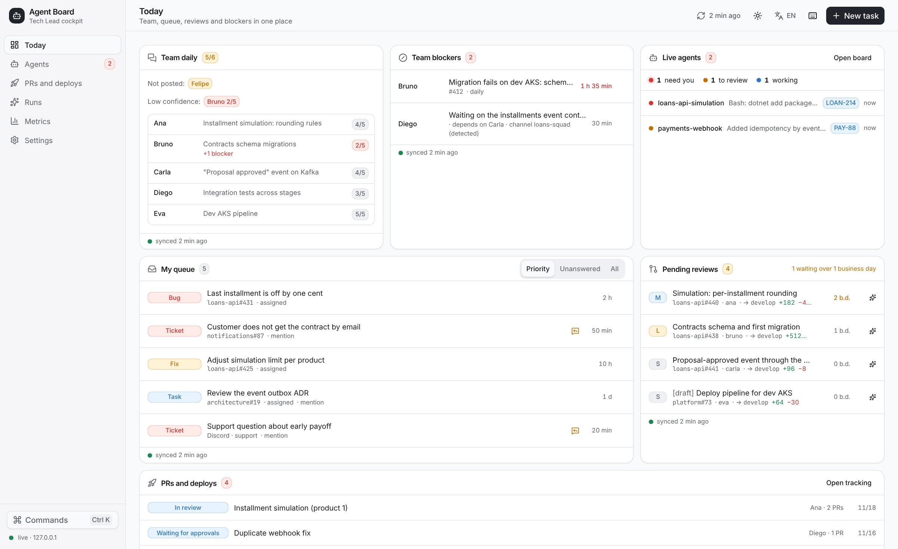

# Agent Board

[](https://github.com/JandersonSR/agent-board/actions/workflows/ci.yml)

**English** · [Português](README.pt-BR.md)

**A local cockpit for Tech Leads.** One screen with your team's daily, your queue, pending reviews, PR and deploy tracking, and the Claude Code and Cursor agents you run in parallel. It runs on your machine only.



*Sample data. The interface is available in English and Portuguese (press `L` to switch).*

---

## Contents

1. [What it does](#what-it-does)
2. [How it works](#how-it-works)
3. [Requirements](#requirements)
4. [Quick start](#quick-start)
5. [Connecting your tools](#connecting-your-tools)
6. [Agent sessions (hooks)](#agent-sessions-hooks)
7. [Background agent runs](#background-agent-runs)
8. [Staff view](#staff-view)
9. [Configuration](#configuration)
10. [Privacy and security](#privacy-and-security)
11. [Language](#language)
12. [Development](#development)
13. [Troubleshooting](#troubleshooting)
14. [Uninstalling](#uninstalling)

---

## What it does

| Screen | What you get |
| --- | --- |
| **Today** | Team daily (who posted, low confidence, new blockers), team blockers with how long each one has been open, your queue (bugs, tickets, tasks, mentions you haven't answered), pending reviews by size and wait time, PRs and deploys, live agents, recent agent runs and an **Attention** block (open incidents, late actions, pending postmortems, stalled decisions, late or blocked product stages) |
| **Agents** | One card per Claude Code or Cursor session, in columns: *Needs you*, *Ready for review*, *Working*, *Idle and ended*. Approve permission requests, see progress, context use and cost, review the diff and open a draft PR |
| **PRs and deploys** | Delivery tracking per issue. The PRs linked to each issue are found and updated automatically, from any author and repository, with status from review queue to merge and the deploy date |
| **Runs** | Background reviews and tasks, with live log, result and the masked prompt. Mark each review finding as kept or discarded; tasks show plan, implementation, verification and diff |
| **Product** | The initiative split into stages with owners (pairs), dependencies, target dates and risks. Progress comes from the linked issues in PRs and deploys; the critical path shows what holds the delivery |
| **Incidents** | Incident log with severity, timeline, impact, the changes that caused it, actions with owner and deadline, and a blameless postmortem exported as Markdown |
| **Decisions** | The team's design docs, RFCs and ADRs with status, owner and decide-by date. ADRs in your local clones are imported in one click |
| **Metrics** | **Agents** (time working and waiting on you, cost), **Team** (flow from PR status history), **DORA** (deploy frequency, lead time, change failure rate, time to restore), **Knowledge** (bus factor per repository, who writes and who reviews) and **AI quality** (precision by prompt version plus a fixed evaluation set that measures what the AI misses) |
| **Settings** | Status of every integration, feature RAGs, cost limits and preferences (language, theme, density, editor, desktop notifications) |

Other details:

- Command palette (`Ctrl K`) and keyboard shortcuts for every screen (`?` lists them).
- Light and dark themes, compact or comfortable density.
- Desktop notifications when an agent needs you or is ready for review.
- Every integration is optional. A block without its integration says what is missing and how to set it up.

---

## How it works

```
Claude Code / Cursor ──hook──▶ hook.js ──▶ ~/.agent-board/sessions/*.json ──┐
                                                                           ▼
GitHub (GraphQL, polling) ─────────────────────────────▶  apps/server (Fastify, 127.0.0.1)  ──▶  apps/web (React)
Discord (read-only bot, polling) ──────────────────────▶        │                                 in your browser
Feature RAGs (local git clones) ───────────────────────▶        ├─▶ MongoDB: board collections painel_* only
                                                                 └─▶ claude -p (isolated background runs)
```

- **`hook.js`** runs on every agent event and writes the session state to a small JSON file. It never blocks your agent.
- **`apps/server`** reads the sessions, polls GitHub and Discord every few minutes, stores its own data in MongoDB and runs background reviews.
- **`apps/web`** is a single-page app served by the server.

Design decisions are recorded in [`docs/adr/`](docs/adr/).

---

## Requirements

| Requirement | Needed for | How to check |
| --- | --- | --- |
| Node.js 20.12 or newer | Everything | `node --version` |
| Claude Code and/or Cursor | Agent sessions and background runs | `claude --version` |
| GitHub CLI, logged in | Queue, reviews, PRs, draft PRs | `gh auth status` |
| MongoDB | PRs and deploys, runs, summaries | A database just for the board |
| A Discord bot (read-only) | Daily, blockers, Discord mentions | See [Discord](#discord) |

---

## Quick start

```bash
git clone https://github.com/JandersonSR/agent-board.git
cd agent-board
npm install
cp .env.example .env      # fill in only what you use; empty = integration off
npm run install-hooks     # Claude Code hooks (see below for Cursor)
npm run build
npm start                 # http://localhost:9999
```

The hooks point to this folder's absolute path. Keep the project in a permanent place, and run `npm run install-hooks` again if you move it.

To check the board without real sessions, run `npm run demo` in a second terminal. Four sample cards appear in **Agents**. Remove them with `npm run demo -- --clear`.

---

## Connecting your tools

### GitHub

- Uses `GITHUB_TOKEN` or, if empty, the token from `gh auth token`.
- Set `GITHUB_ORG`, plus `TEAM_GITHUB_LOGINS` to follow your team's PRs.
- Deploy dates come from a GitHub Project field when `GITHUB_PROJECTS` is set and the token has the `read:project` scope (`gh auth refresh -s read:project`). Without it, you type the date on the board.

### Discord

The board reads Discord through a private bot with **read-only** permissions. It never sends messages.

1. Discord Developer Portal → **New Application**.
2. **Bot** tab: **Reset Token** → `DISCORD_BOT_TOKEN`. Turn on **Message Content Intent** and turn off **Public Bot**.
3. **OAuth2 → URL Generator**: scope `bot`, permissions **only** *View Channels* and *Read Message History*.
4. A server admin opens the URL and adds the bot.
5. With Developer Mode on, copy the server, channel and user IDs into `.env` (`DISCORD_GUILD_ID`, `DISCORD_DAILY_CHANNEL_ID`, `DISCORD_WATCH_CHANNELS`, `DISCORD_MY_USER_ID`, `TEAM_DISCORD_MEMBERS`).

### MongoDB

The board only writes to its own collections, `painel_resumos`, `painel_sessoes`, `painel_prs`, `painel_incidentes`, `painel_decisoes`, `painel_iniciativas` and `painel_avaliacoes`, enforced by an allowlist in code. Use a database and a user just for the board (`MONGO_URI`, or `MONGO_DATABASE_*`). The board starts without MongoDB; the blocks that need it say so.

### Feature RAGs and skills

Background reviews can use one or more feature maps (git clones with `AGENTS.md` and `packs/_index.yaml`) and the review skill from your team's skills kit. Set `FEAT_MAPS`, `FEAT_MAP_ROUTES`, `SKILLS_KIT_PATH` and `SKILL_NAMES`. **Settings** shows the status of each map and lets you test the search.

---

## Agent sessions (hooks)

```bash
npm run install-hooks     # Claude Code: ~/.claude/settings.json
npm run install-cursor    # Cursor: ~/.cursor/hooks.json
```

The installer backs up your file (`.bak-agent-board`), keeps your other hooks and never adds duplicates. Restart running sessions so they load the hooks.

On the **Agents** screen:

| Column | A card moves here when… |
| --- | --- |
| Needs you | The agent asked for permission or is waiting on a question |
| Ready for review | The agent finished its turn |
| Working | You sent a prompt or the agent is using tools |
| Idle and ended | The session has no prompt yet, or was closed |

- **Approvals:** permission requests show the exact command with **Allow** and **Deny**. The hook waits for the board only while it is open in a browser tab, for up to `AGENT_BOARD_APPROVAL_WAIT` seconds (default 120). Otherwise the terminal asks as usual. Cursor has no equivalent event, so Cursor cards have no approval buttons.
- **Changes:** the diff against the base branch, file by file, PR and CI status, and **Create draft PR** (with confirmation, never from `main`, `master`, `develop` or `production*`).
- **New task** (`N`): creates a git worktree and opens Claude Code or Cursor in it.
- **By task:** groups sessions by task ID (`FEAT-123`) found in the branch or the first prompt.
- **Phone push (optional):** set `AGENT_BOARD_NTFY` to an [ntfy](https://ntfy.sh) topic. The push carries only the folder, branch and state. Anyone who knows the topic name can read it, so pick a hard-to-guess name or a self-hosted server.

---

## Background agent runs

The ✨ button on a pending review asks Claude to review the PR in the background:

1. You see the full prompt first (review skill + relevant features from the RAGs), already masked, and can edit it.
2. Claude runs with `claude -p`, isolated from your global settings, and **read-only**: it can read the PR and the feature map, and cannot comment, approve, push or browse the web.
3. The result (verdict, risks, findings by file and line) appears in **Runs**.
4. **Create PENDING review** turns the findings into a pending review under your name. Only you can submit it on GitHub. Nothing is approved automatically.

Limits: `MAX_CONCURRENT_SESSIONS`, `SESSION_TIMEOUT_MIN` and `MAX_DAILY_RUNS`. `ANTHROPIC_API_KEY` is removed from the run environment so it never bills the API by mistake.

### Measuring AI review quality

Each finding in a review run has **Keep** and **Discard** buttons. Discarded findings never reach GitHub. Your calls feed **Metrics → AI quality**: precision (kept ÷ judged) by prompt version, severity and repository, judging coverage and cost per kept finding. The prompt version is a hash of the review skill, so changing the skill shows up as a new version and you can compare them. Precision is flagged as unreliable while fewer than half of the findings are judged.

### Tasks from issue to draft PR

The wand on a GitHub issue in **My queue** runs a task in three gated steps:

1. **Plan (read-only).** You see and can edit the masked prompt. The agent reads the code and returns a plan: steps, files, tests, risks and questions.
2. **Approval.** You answer the questions in the notes and click **Approve plan and implement**. The agent works in an isolated git worktree on `agent/<number>-<slug>`. It can only run the allowed test commands and local git (`status`, `diff`, `add`, `commit`). Push, `gh`, network and destructive commands are blocked.
3. **Independent verification.** The board itself runs `TASK_VERIFY` for the repository, so the result does not depend on what the agent reports. You see the diff by file and the full patch.

**Create draft PR** pushes the branch and opens a draft PR that closes the issue. It always asks for confirmation. **Discard** stops the agent and deletes the worktree and the local branch; the history stays in Runs.

### AI pre-review in the team's CI (opt-in)

`.github/workflows/ai-review.yml` is a reusable workflow that team repositories can call. It posts one comment per PR (updated on each push) and never approves, requests changes or pushes. The agent gets the PR and the diff in the prompt and can only read the checkout. See [docs/ci-ai-review.md](docs/ci-ai-review.md). **It sends code to the model provider, so it needs company approval** and an `ANTHROPIC_API_KEY` secret.

### Measuring what the AI misses

Precision only shows what the AI flagged for nothing. **Metrics → AI quality → Fixed set** measures recall: register 5 to 10 PRs (old ones are fine) with problems you already know, giving for each one the file and the words a good review would use. **Run all** reviews each case with the current prompt version, one at a time and within the cost limits. A problem counts as found when a finding is in the same file and has one of the words, or is within 10 lines. Evaluation runs never become a GitHub review. The cases live in the board's MongoDB, not in the repository.

---

## Staff view

| Where | What it measures | Source |
| --- | --- | --- |
| **Metrics → DORA** | Deploy frequency, lead time (median and p90), change failure rate and time to restore, by week, plus the list of failed deliveries | Deploy dates of merged issues; fixes matched by `DORA_FAILURE_RE` (hotfix, rollback, revert…); incidents that name a change as the cause |
| **Metrics → Knowledge** | Bus factor per repository, share of the top author and reviewer, PRs merged without review, people who review 80%+ of a repository | Authors and reviewers of merged PRs (reviewers are recorded from this version on) |
| **Incidents** | Open incidents, late actions, % of actions done, pending postmortems (SEV1/SEV2) | Your incident log |
| **Decisions** | Open decisions past deadline, due in 7 days, or stalled for 3+ weeks without a deadline | Manual entries and ADRs imported from `docs/adr`, `docs/decisions` and similar folders |
| **Product** | Progress per stage, stages waiting on a dependency, late stages, open high risks, critical path | Issues tracked in PRs and deploys, linked by URL, `repo#123` or text in the title |

These numbers measure the process, not people. Use them in retros and planning to find bottlenecks and risks, and to show before-and-after when you change something.

---

## Configuration

All settings live in `.env`. [`.env.example`](.env.example) lists every variable with a comment. Empty means off.

| Group | Main variables |
| --- | --- |
| Server | `AGENT_BOARD_PORT` (default 9999), `AGENT_BOARD_DIR`, `AGENT_BOARD_APPROVAL_WAIT`, `AGENT_BOARD_TASK_RE`, `AGENT_BOARD_NTFY` |
| MongoDB | `MONGO_URI` or `MONGO_DATABASE_NAME/USER/PASS/CLUSTERNAME` |
| GitHub | `GITHUB_TOKEN`, `GITHUB_ORG`, `GITHUB_LOGIN`, `TEAM_GITHUB_LOGINS`, `GITHUB_PROJECTS`, `DEPLOY_*` |
| Discord | `DISCORD_BOT_TOKEN`, `DISCORD_GUILD_ID`, `DISCORD_DAILY_CHANNEL_ID`, `DISCORD_WATCH_CHANNELS`, `DISCORD_MY_USER_ID`, `TEAM_DISCORD_MEMBERS` |
| Team and queue | `TEAM_TZ_OFFSET_MIN`, `HOLIDAYS`, `QUEUE_TYPE_ORDER` |
| Agent context | `FEAT_MAPS`, `FEAT_MAP_ROUTES`, `FEAT_CONTEXT_TOKENS`, `SKILLS_KIT_PATH`, `SKILL_NAMES`, `REPOS`, `WORKTREES_DIR`, `AGENT_MODEL_*` |
| Tasks | `TASK_TEST_COMMANDS`, `TASK_VERIFY` |
| DORA | `DORA_FAILURE_RE` |
| Cost limits | `MAX_CONCURRENT_SESSIONS`, `SESSION_TIMEOUT_MIN`, `MAX_DAILY_RUNS`, `POLL_INTERVAL_MIN` |
| Privacy | `MASK_EXTRA_PATTERNS` |

Real environment variables take priority over `.env`. Restart the server after changing it.

---

## Privacy and security

- The server listens on **127.0.0.1 only**. This is not configurable.
- It checks the `Host` header (against DNS rebinding). Every write needs an `X-Agent-Board` header and a local `Origin`, so no website open in your browser can approve tool calls, start agents or open PRs.
- **Personal data is masked** (CPF, CNPJ, emails, phones, cards, bank details, income, tokens) before any text goes to a model, to the database or to an error message. Extra patterns go in `MASK_EXTRA_PATTERNS`.
- Discord is read through a **read-only bot**. The board never sends Discord messages.
- MongoDB writes are limited to the board's own collections. No index is created on other collections.
- Nothing is posted to GitHub without your click: draft PRs and pending reviews always ask for confirmation.
- Secrets live only in `.env`, which is git-ignored. They are never shown on screen or logged.
- Before using it at work, check that your company allows the AI tools and the integrations you turn on.

---

## Language

The interface is available in **English** and **Portuguese (Brazil)**. The first visit follows your browser language. Switch any time with the **EN/PT** button in the header, the `L` shortcut or **Settings → Language**.

Texts written by people and tools (issue titles, daily messages, agent replies) stay in their original language.

---

## Development

```bash
npm run dev          # API (tsx watch) + web (Vite, http://127.0.0.1:5173)
npm test             # hooks (node --test) + server + web (Vitest)
npm run typecheck
npm run build && npm start
```

```
agent-board/
├── apps/
│   ├── server/        # Fastify + Zod: routes, GitHub/Discord sync, MongoDB, agent runs, masking
│   └── web/           # React + Vite + Tailwind + shadcn/ui
├── hook.js            # Agent hook (plain JavaScript, no dependencies, starts in milliseconds)
├── install.js         # Installs/removes hooks for Claude Code or Cursor
├── demo.js            # Sample agent sessions
├── lib/               # Hook libraries: session state, transcript usage, pricing
├── docs/adr/          # Architecture decision records
├── ci/                # AI pre-review script for the reusable workflow
├── .github/workflows/ # CI and the reusable AI review
└── .env.example
```

**Adding UI text:** write the Portuguese text inside `t('…')` (or `k('…')` in constants) and add the English version to `apps/web/src/lib/i18n-en.ts`. A test fails if any text has no translation or if the `{variables}` differ.

The previous single-file server is still available as `npm run start:legacy` until it is removed.

---

## Troubleshooting

| Problem | What to do |
| --- | --- |
| No card for a real session | Restart the session. Check `/hooks` inside Claude Code, and that `~/.agent-board/sessions` gets one JSON per session. If you moved the folder, run `npm run install-hooks` again |
| A block says "not configured" | Fill in the variables it names in `.env` and restart. **Settings** shows what is missing |
| `EADDRINUSE` on start | Port 9999 is in use. Set `AGENT_BOARD_PORT` |
| A card is stuck in the wrong column | A crashed session may never send its last event. **Dismiss** it; the next event recreates it |
| Project dates don't show | The token lacks `read:project`. Run `gh auth refresh -s read:project` and set `GITHUB_PROJECTS` |
| Installer says "invalid JSON" | Fix your `settings.json`/`hooks.json` or restore the `.bak-agent-board` backup, then install again |

---

## Uninstalling

```bash
npm run uninstall-hooks     # Claude Code
npm run uninstall-cursor    # Cursor
```

Only the board's hooks are removed. Then delete the project folder and, if you want, `~/.agent-board`.

## License

MIT
