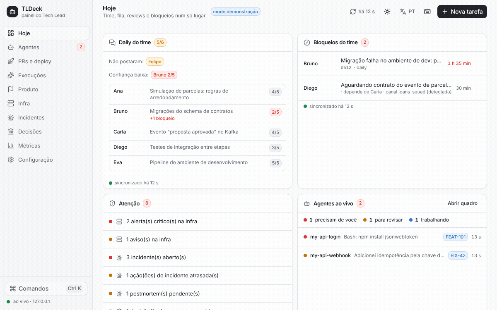
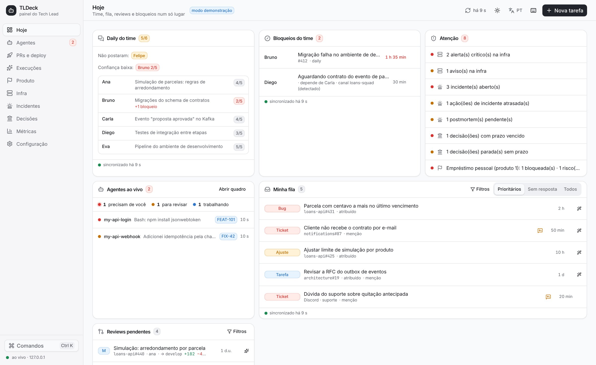

# TLDeck

[](https://github.com/JandersonSR/tldeck/actions/workflows/ci.yml)
[](LICENSE)


[English](README.md) · **Português**

**O painel local do Tech Lead que trabalha com agentes de IA.** O time, a fila, as entregas e os agentes de IA numa tela só, com a IA sob controle e medida. Tudo roda só na sua máquina.

Se você lidera um time e roda agentes do Claude Code ou do Cursor em paralelo, o seu dia fica espalhado entre Discord, GitHub, terminais e planilhas. O TLDeck junta tudo:

- **Dia a dia:** a daily do time, os bloqueios com o tempo de cada um, a sua fila (bugs, tickets, menções sem resposta), os reviews pendentes por tamanho e espera, e um bloco **Atenção** com o que está atrasado ou parado.
- **Entrega e confiabilidade:** acompanhamento de PRs e deploy por issue, fluxo do time, métricas **DORA**, incidentes com postmortem sem culpados, as decisões do time com dono e prazo, e o produto dividido em etapas com dependências, riscos e caminho crítico.
- **IA sob controle:** todas as sessões de agentes num lugar, reviews de PR e tarefas da issue até o PR em rascunho em segundo plano, com portão humano em cada passo, e a IA **medida** pelos dois lados: o que ela aponta à toa (precisão) e o que deixa passar (recall).



## Teste em um minuto

Sem configurar nada. Precisa do Node.js 22.13 ou mais novo.

```bash
git clone https://github.com/JandersonSR/tldeck.git
cd tldeck
npm install
npm run demo        # abre em http://127.0.0.1:9999 com dados fictícios (-- --en para inglês)
```

O demo não usa nenhuma integração real, mesmo que exista um `.env`, e guarda os dados numa pasta temporária.

## Por que não X?

Boas ferramentas já cobrem partes disso. Use-as se uma parte é tudo de que você precisa; o TLDeck é para o Tech Lead que precisa das partes juntas, na própria máquina.

| Se você só precisa de… | Uma boa escolha | O que o TLDeck acrescenta |
| --- | --- | --- |
| Gerenciar sessões paralelas do Claude Code | O agent view do próprio Claude Code (`claude agents`) | Sessões do Cursor também, aprovação pelo navegador e essas sessões ao lado da fila, dos reviews e do time (a aba **Em segundo plano** lê o `claude agents`) |
| DORA e métricas de engenharia de muitos times | Apache DevLake, Middleware | Nada para configurar (SQLite local), incidente ligado à mudança que o causou, concentração de conhecimento, decisões e etapas do produto no mesmo lugar |
| Review de PR por IA no CI | PR-Agent, CodeRabbit | Precisão e recall medidos por versão do prompt, achados que você julga antes de qualquer coisa ir ao GitHub, e uma pré-review opt-in no CI que só comenta |
| Análise de entrega como serviço | LinearB, Swarmia e parecidos | Roda só na sua máquina, com dados pessoais mascarados antes de guardar ou enviar a um modelo |

## Segurança e privacidade

- O servidor escuta **só em 127.0.0.1**, confere o cabeçalho `Host` e exige `Origin` local e um cabeçalho próprio em toda escrita, então nenhum site aberto no navegador dispara ações.
- **Dados pessoais são mascarados** (CPF, CNPJ, e-mails, telefones, cartões, dados bancários, renda, tokens) antes de qualquer texto ir para um modelo, para o banco ou para uma mensagem de erro.
- **Nada é publicado sem o seu clique:** PR em rascunho, review pendente e parar um agente sempre pedem confirmação. O bot do Discord só lê.
- Os agentes em segundo plano rodam isolados das suas configurações globais; os de review só leem.
- Antes de usar no trabalho, confirme que a empresa permite as ferramentas de IA e as integrações que você ligar. Detalhes em [Privacidade e segurança](#privacidade-e-segurança).

## Sumário

1. [O que ele faz](#o-que-ele-faz)
2. [Como funciona](#como-funciona)
3. [Requisitos](#requisitos)
4. [Instalação para uso real](#instalação-para-uso-real)
5. [Conectando suas ferramentas](#conectando-suas-ferramentas)
6. [Sessões de agentes (hooks)](#sessões-de-agentes-hooks)
7. [Execuções em segundo plano](#execuções-em-segundo-plano)
8. [Visão de Staff](#visão-de-staff)
9. [Infra em tempo real](#infra-em-tempo-real)
10. [Configuração](#configuração)
11. [Privacidade e segurança](#privacidade-e-segurança)
12. [Idioma](#idioma)
13. [Desenvolvimento](#desenvolvimento)
14. [Problemas comuns](#problemas-comuns)
15. [Desinstalação](#desinstalação)
16. [Como contribuir e roadmap](#como-contribuir-e-roadmap)

---

## O que ele faz

| Tela | O que você tem |
| --- | --- |
| **Hoje** | Daily do time (quem postou, confiança baixa, bloqueios novos), bloqueios do time com o tempo de cada um, sua fila (bugs, tickets, tarefas, menções sem resposta sua), reviews pendentes por tamanho e tempo de espera, PRs e deploy, agentes ao vivo, as últimas execuções e um bloco **Atenção** (incidentes abertos, ações atrasadas, postmortems pendentes, decisões paradas, etapas do produto atrasadas ou bloqueadas) |
| **Agentes** | Um card por sessão do Claude Code ou do Cursor (uma aba para cada ferramenta, ou as duas), em colunas: *Precisa de você*, *Pronto para revisar*, *Trabalhando*, *Ociosas e encerradas*. Aprove pedidos de permissão, veja progresso, uso de contexto e custo, revise o diff e abra um PR em rascunho. A aba **Em segundo plano** lista as sessões do agent view do Claude Code (`claude agents`): estado, o que cada uma espera, logs, o comando para anexar e parar |
| **Fila** | Tudo atribuído a você ou que te menciona (issues do GitHub, Jira, Linear e menções no chat), uma aba por tipo na ordem de prioridade (*Ticket*, *Bug*, *Ajuste*, *Tarefa*, depois o resto, conforme `QUEUE_TYPE_ORDER`). Filtre por título, chave ou etiqueta, origem e menções sem resposta; ordene por prioridade, mais antigos ou mais tempo sem atualização. Inicie uma tarefa de agente numa issue do GitHub ou transforme qualquer issue num incidente com um clique |
| **PRs e deploy** | Acompanhamento por issue. Os PRs ligados a cada issue são encontrados e atualizados sozinhos, de qualquer autor e repositório, com o status da fila de review até o merge e **em produção**, e a data de deploy. PR mergeado numa branch de produção (`DEPLOY_PROD_BRANCHES`, padrão `production,production-*`) ou status ajustado à mão para *Em produção* encerra o card: o acompanhamento automático para |
| **Execuções** | Reviews e tarefas em segundo plano, com log ao vivo, resultado e o prompt mascarado. Cada achado de review pode ser mantido ou descartado; tarefas mostram plano, implementação, verificação e diff |
| **Produto** | A iniciativa dividida em etapas com donos (duplas), dependências, datas alvo e riscos. O progresso vem das issues ligadas em PRs e deploy; o caminho crítico mostra o que segura a entrega |
| **Infra** | Servidores e apps do DigitalOcean, Heroku, Azure e Grafana em tempo real: estado, CPU e memória, o que roda cada app (dynos, tamanho das instâncias), alertas disparados com o deploy que pode ter causado, e linha do tempo. Uma aba por provedor, com filtros por nome, estado e tipo e ordenação por CPU ou memória. Tokens só de leitura |
| **Incidentes** | Registro com severidade, linha do tempo, impacto, as mudanças que causaram, ações com dono e prazo, e postmortem sem culpados exportado em Markdown |
| **Decisões** | Design docs, RFCs e ADRs do time com status, dono e prazo para decidir. Os ADRs dos clones locais são importados com um clique |
| **Métricas** | **Agentes** (tempo trabalhando e esperando você, custo), **Time** (fluxo a partir do histórico de status dos PRs), **DORA** (frequência de deploy, tempo de entrega, taxa de falha de mudança, tempo de recuperação), **Conhecimento** (fator de ônibus por repositório, quem escreve e quem revisa) e **Qualidade da IA** (precisão por versão do prompt e um conjunto fixo que mede o que a IA deixa passar) |
| **Configuração** | Estado de cada integração, RAGs de features, limites de custo e preferências (idioma, tema, densidade, editor, notificações no desktop) |

Outros detalhes:

- Paleta de comandos (`Ctrl K`) e atalhos de teclado para todas as telas (`?` mostra a lista).
- Tema claro e escuro, densidade compacta ou confortável.
- Notificação no desktop quando um agente precisa de você ou fica pronto para revisar.
- Toda integração é opcional. Um bloco sem a integração dele diz o que falta e como configurar.




*Dados de exemplo do demo. A interface está em português e inglês (aperte `L` para trocar).*

---

## Como funciona

```
Claude Code / Cursor ──hook──▶ hook.js ──▶ ~/.agent-board/sessions/*.json ──┐
                                                                           ▼
GitHub (GraphQL, polling) ─────────────────────────────▶  apps/server (Fastify, 127.0.0.1)  ──▶  apps/web (React)
Discord (bot só leitura, polling) ─────────────────────▶        │                                 no seu navegador
RAGs de features (clones git locais) ──────────────────▶        ├─▶ arquivo SQLite local (ou MongoDB): só dados do painel
                                                                 └─▶ claude -p (execuções isoladas)
```

- **`hook.js`** roda a cada evento do agente e grava o estado da sessão num JSON pequeno. Ele nunca trava o agente.
- **`apps/server`** lê as sessões, consulta GitHub e Discord a cada poucos minutos, guarda os próprios dados num arquivo SQLite local (ou no MongoDB) e roda as reviews em segundo plano.
- **`apps/web`** é uma página única servida pelo servidor.

As decisões de arquitetura ficam em [`docs/adr/`](docs/adr/).


---

## Requisitos

| Requisito | Para quê | Como conferir |
| --- | --- | --- |
| Node.js 22.13 ou mais novo | Tudo (inclui o SQLite embutido) | `node --version` |
| Claude Code e/ou Cursor | Sessões de agentes e execuções em segundo plano | `claude --version` |
| GitHub CLI, logado | Fila, reviews, PRs, PRs em rascunho | `gh auth status` |
| MongoDB (opcional) | Só se quiser um banco compartilhado; o padrão é um arquivo SQLite local | Um banco só do painel |
| Um bot do Discord (só leitura) | Daily, bloqueios, menções no Discord | Veja [Discord](#discord) |


---

## Instalação para uso real

```bash
git clone https://github.com/JandersonSR/tldeck.git
cd tldeck
npm install
cp .env.example .env      # preencha só o que usar; vazio = integração desligada
npm run install-hooks     # hooks do Claude Code (o Cursor está mais abaixo)
npm run build
npm start                 # http://localhost:9999
```

Os hooks apontam para o caminho absoluto desta pasta. Deixe o projeto num lugar fixo e rode `npm run install-hooks` de novo se mudar a pasta de lugar.

Para colocar cards de agentes de exemplo num painel real, rode `npm run demo:sessions` num segundo terminal. Remova com `npm run demo:sessions -- --clear`.


---

## Conectando suas ferramentas

### GitHub

- Usa `GITHUB_TOKEN` ou, se estiver vazio, o token do `gh auth token`.
- Defina `GITHUB_ORG` e, para acompanhar os PRs do time, `TEAM_GITHUB_LOGINS`.
- A data de deploy vem de um campo do GitHub Project quando `GITHUB_PROJECTS` está definido e o token tem o escopo `read:project` (`gh auth refresh -s read:project`). Sem isso, você informa a data no painel.

### Discord

O painel lê o Discord por um bot privado com permissões **só de leitura**. Ele nunca envia mensagens.

1. Discord Developer Portal → **New Application**.
2. Aba **Bot**: **Reset Token** → `DISCORD_BOT_TOKEN`. Ative **Message Content Intent** e desative **Public Bot**.
3. **OAuth2 → URL Generator**: scope `bot`, permissões **só** *View Channels* e *Read Message History*.
4. Um admin do servidor abre a URL e adiciona o bot.
5. Com o Modo desenvolvedor ligado, copie os IDs do servidor, dos canais e do seu usuário para o `.env` (`DISCORD_GUILD_ID`, `DISCORD_DAILY_CHANNEL_ID`, `DISCORD_WATCH_CHANNELS`, `DISCORD_MY_USER_ID`, `TEAM_DISCORD_MEMBERS`).

### Slack (no lugar do Discord)

Os mesmos blocos (daily do time, bloqueios, menções na fila) podem ler o Slack. Um chat por vez: o Slack é usado quando só `SLACK_BOT_TOKEN` está preenchido, ou com `CHAT_PROVIDER=slack`.

1. api.slack.com/apps → **Create New App** no seu próprio workspace (um app interno; os limites mais rígidos de histórico do Slack valem só para apps distribuídos fora do Marketplace).
2. **OAuth & Permissions** → escopos do bot **só** `channels:history`, `groups:history`, `users:read` e `usergroups:read`. Instale e copie o **Bot User OAuth Token** para `SLACK_BOT_TOKEN`.
3. Convide o app para o canal da daily e para os canais observados (`/invite @seu-app`).
4. Preencha `SLACK_DAILY_CHANNEL_ID`, `SLACK_WATCH_CHANNELS` (`rótulo:channelId`), `SLACK_MY_USER_ID`, `SLACK_MY_GROUP_IDS` (grupos que te mencionam, ex.: `@leads`) e `TEAM_SLACK_MEMBERS` (`memberId:nome`).

Uma menção conta como respondida quando você respondeu na thread ou escreveu depois no canal. O formato da daily é o mesmo do Discord (negrito com `*x*` também funciona).

### Jira e Linear

Além do GitHub Issues (e do GitHub Projects para as datas de deploy), a fila e o acompanhamento de deploy podem ler o Jira e o Linear, só leitura.

| Ferramenta | Acesso | O que acrescenta |
| --- | --- | --- |
| **Jira Cloud** | `JIRA_BASE_URL`, `JIRA_EMAIL` e um token de API (`JIRA_API_TOKEN`) de uma conta com acesso de leitura | Sua fila: `JIRA_JQL` (padrão: atribuídas a você e não concluídas). Data de deploy de um campo de data (`JIRA_DEPLOY_DATE_FIELD`, ex.: `customfield_10050`) |
| **Linear** | Uma chave de API pessoal (`LINEAR_API_KEY`) | Sua fila: issues atribuídas a você e não terminadas. Com `LINEAR_DUE_DATE_IS_DEPLOY=true`, o prazo vira a data de deploy |

Com as chaves dos projetos (`JIRA_PROJECT_KEYS=LOAN,CRM`, `LINEAR_TEAM_KEYS=ENG`), os PRs que citam uma chave no título, na branch ou na descrição ficam agrupados nessa issue em **PRs e deploy**, com o título, o estado e a data de deploy da ferramenta. Também dá para acompanhar uma issue digitando a chave (`LOAN-214`) ou o link.

### Dados: SQLite local ou MongoDB

Por padrão o painel guarda os dados num arquivo SQLite local (`~/.agent-board/data.db`, ou `AGENT_BOARD_DB`). Sem servidor e sem instalar nada. Preencha `MONGO_URI` (ou `MONGO_DATABASE_*`) para usar MongoDB, por exemplo para compartilhar os dados entre máquinas.

O painel só escreve nas próprias coleções, `deck_summaries`, `deck_runs`, `deck_prs`, `deck_incidents`, `deck_decisions`, `deck_initiatives` e `deck_evals`, e o código impõe isso com uma lista permitida. Com MongoDB, use um banco e um usuário só do painel.

### RAGs de features e skills

As reviews em segundo plano podem usar um ou mais mapas de features (clones git com `AGENTS.md` e `packs/_index.yaml`) e a skill de review do kit do time. Defina `FEAT_MAPS`, `FEAT_MAP_ROUTES`, `SKILLS_KIT_PATH` e `SKILL_NAMES`. **Configuração** mostra o estado de cada mapa e permite testar a busca.


---

## Sessões de agentes (hooks)

```bash
npm run install-hooks     # Claude Code: ~/.claude/settings.json
npm run install-cursor    # Cursor: ~/.cursor/hooks.json
```

O instalador faz backup do seu arquivo (`.bak-agent-board`), mantém os seus outros hooks e nunca duplica. Reinicie as sessões abertas para elas carregarem os hooks.

Na tela **Agentes**:

| Coluna | O card vai para cá quando… |
| --- | --- |
| Precisa de você | O agente pediu permissão ou está esperando uma resposta |
| Pronto para revisar | O agente terminou o turno |
| Trabalhando | Você mandou um prompt ou o agente está usando ferramentas |
| Ociosas e encerradas | A sessão ainda não tem prompt, ou foi fechada |

- **Aprovações:** pedidos de permissão mostram o comando exato com **Permitir** e **Negar**. O hook espera o painel só enquanto ele está aberto numa aba, por até `AGENT_BOARD_APPROVAL_WAIT` segundos (padrão 120). Fora disso, o terminal pergunta normalmente. O Cursor não tem evento equivalente, então os cards do Cursor não têm botões de aprovação.
- **Mudanças:** diff contra a branch base, arquivo por arquivo, status do PR e do CI, e **Criar PR rascunho** (com confirmação e nunca a partir de `main`, `master`, `develop` ou `production*`).
- **Nova tarefa** (`N`): cria um worktree do git e abre o Claude Code ou o Cursor nele.
- **Por tarefa:** agrupa sessões pelo ID da tarefa (`FEAT-123`) encontrado na branch ou no primeiro prompt.
- **Push no celular (opcional):** defina `AGENT_BOARD_NTFY` com um tópico do [ntfy](https://ntfy.sh). O push leva só a pasta, a branch e o estado. Quem souber o nome do tópico consegue ler, então use um nome difícil de adivinhar ou um servidor próprio.


---

## Execuções em segundo plano

O botão ✨ num review pendente pede ao Claude que revise o PR em segundo plano:

1. Você vê antes o prompt completo (skill de review + features relevantes dos RAGs), já mascarado, e pode editar.
2. O Claude roda com `claude -p`, isolado das suas configurações globais e **só com leitura**: ele lê o PR e o mapa de features, e não consegue comentar, aprovar, fazer push nem navegar na web.
3. O resultado (veredito, riscos, achados por arquivo e linha) aparece em **Execuções**.
4. **Criar review PENDING** transforma os achados numa review pendente no seu nome. Só você pode submetê-la no GitHub. Nada é aprovado automaticamente.

Limites: `MAX_CONCURRENT_SESSIONS`, `SESSION_TIMEOUT_MIN` e `MAX_DAILY_RUNS`. A `ANTHROPIC_API_KEY` é removida do ambiente da execução, para nunca cobrar a API por engano.

### Medindo a qualidade da review por IA

Cada achado de uma review tem os botões **Manter** e **Descartar**. Os descartados não vão para o GitHub. O seu julgamento alimenta **Métricas → Qualidade da IA**: precisão (mantidos ÷ julgados) por versão do prompt, severidade e repositório, cobertura do julgamento e custo por achado mantido. A versão do prompt é um hash da skill de review: mudou a skill, aparece uma versão nova, e dá para comparar. Enquanto menos da metade dos achados estiver julgada, a tela avisa que a precisão ainda não é confiável.

### Tarefas da issue ao PR em rascunho

A varinha numa issue do GitHub em **Minha fila** roda uma tarefa em três etapas com portão:

1. **Plano (só leitura).** Você vê e pode editar o prompt mascarado. O agente lê o código e devolve um plano: passos, arquivos, testes, riscos e dúvidas.
2. **Aprovação.** Você responde as dúvidas nas observações e clica em **Aprovar plano e implementar**. O agente trabalha numa worktree isolada, na branch `agent/<número>-<slug>`. Ele só roda os comandos de teste permitidos e git local (`status`, `diff`, `add`, `commit`). Push, `gh`, rede e comandos destrutivos ficam bloqueados.
3. **Verificação independente.** O próprio painel roda o `TASK_VERIFY` do repositório, para o resultado não depender do que o agente diz. Você vê o diff por arquivo e o patch completo.

**Criar PR rascunho** faz push da branch e abre um PR em rascunho que fecha a issue, sempre com confirmação. **Descartar** para o agente e apaga a worktree e a branch local; o histórico fica em Execuções.

### Pré-review por IA no CI do time (opt-in)

`.github/workflows/ai-review.yml` é um workflow reutilizável que os repositórios do time podem chamar. Ele posta um comentário por PR (atualizado a cada push) e nunca aprova, pede mudanças ou faz push. O agente recebe o PR e o diff no prompt e só consegue ler o checkout. Veja [docs/ci-ai-review.md](docs/ci-ai-review.md). **Ele envia código ao provedor do modelo, então precisa de aprovação da empresa** e de um secret `ANTHROPIC_API_KEY`.

### Medindo o que a IA deixa passar

A precisão só mostra o que a IA apontou à toa. **Métricas → Qualidade da IA → Conjunto fixo** mede o recall: cadastre de 5 a 10 PRs (podem ser antigos) com problemas que vocês já conhecem, dizendo para cada um o arquivo e as palavras que uma boa review usaria. **Rodar todos** faz a review de cada caso com a versão atual do prompt, um de cada vez e dentro dos limites de custo. Um problema conta como encontrado quando um achado está no mesmo arquivo e tem uma das palavras, ou fica a até 10 linhas. Execuções de avaliação nunca viram review no GitHub. Os casos ficam no MongoDB do painel, não no repositório.


---

## Visão de Staff

| Onde | O que mede | De onde vem |
| --- | --- | --- |
| **Métricas → DORA** | Frequência de deploy, tempo de entrega (mediana e p90), taxa de falha de mudança e tempo de recuperação, por semana, e a lista das entregas com falha | Datas de deploy das issues mergeadas; correções pela `DORA_FAILURE_RE` (hotfix, rollback, revert…); incidentes que apontam uma mudança como causa |
| **Métricas → Conhecimento** | Fator de ônibus por repositório, participação de quem mais escreve e mais revisa, PRs mergeados sem review, pessoas que revisam 80% ou mais de um repositório | Autores e revisores dos PRs mergeados (revisores registrados a partir desta versão) |
| **Incidentes** | Incidentes abertos, ações atrasadas, % de ações concluídas, postmortems pendentes (SEV1/SEV2) | O seu registro de incidentes |
| **Decisões** | Decisões abertas com prazo vencido, vencendo em 7 dias ou paradas há mais de 3 semanas sem prazo | Cadastro manual e ADRs importados de `docs/adr`, `docs/decisions` e pastas parecidas |
| **Produto** | Progresso por etapa, etapas esperando dependência, atrasadas, riscos altos abertos, caminho crítico | Issues acompanhadas em PRs e deploy, ligadas por URL, `repo#123` ou texto no título |

Esses números medem o processo, não as pessoas. Use na retro e no planejamento para achar gargalos e riscos, e para mostrar o antes e depois quando mudar alguma coisa.

---

## Infra em tempo real

A tela **Infra** (`G S`) mostra seus servidores e apps, os alertas disparados e os deploys, atualizados a cada minuto. Ela só **lê**: todos os tokens abaixo podem ser só de leitura, e nada na sua infraestrutura é alterado.

| Provedor | O que lê | Acesso só de leitura |
| --- | --- | --- |
| **DigitalOcean** | Droplets (estado, CPU e memória pela API de monitoramento), apps do App Platform (componentes com tamanho e quantidade de instâncias, CPU e memória com `monitoring:read`) e seus deployments | Token pessoal com escopo **read** (`DIGITALOCEAN_TOKEN`). `DIGITALOCEAN_TAG` limita aos droplets com uma tag. Token com escopo customizado também serve: só com `app:read` os apps são lidos e o provedor aparece como *parcial* (droplets pedem `droplet:read`, CPU/memória pedem `monitoring:read`) |
| **Heroku** | Apps, dynos por tipo de processo (quantos no ar, tamanho) e releases. A API de plataforma não tem CPU nem memória | `HEROKU_API_KEY` de uma conta com acesso de visualização; liste os apps em `HEROKU_APPS` |
| **Azure** | Resource Health (disponível, degradado, indisponível) e alertas disparados do Azure Monitor da assinatura | Service principal com o papel **Monitoring Reader**: `AZURE_TENANT_ID`, `AZURE_CLIENT_ID`, `AZURE_CLIENT_SECRET`, `AZURE_SUBSCRIPTION_ID` |
| **Grafana** | Alertas disparados do Grafana Alerting (vale também para alertas sobre dados do Prometheus, Loki ou Datadog) | Token de service account com papel **Viewer**: `GRAFANA_URL`, `GRAFANA_TOKEN` |

**O que ele faz com isso:**

- **Alertas por limite:** CPU acima de `INFRA_CPU_CRIT` (90%) ou memória acima de `INFRA_MEM_CRIT` (90%) por `INFRA_SUSTAIN_MIN` (5) minutos vira alerta crítico; acima de `INFRA_CPU_WARN` (80%), aviso. Recurso fora do ar também é alerta crítico. Os alertas dos provedores (Azure Monitor, Grafana) entram como vierem.
- **Possível causa:** um deploy bem-sucedido do mesmo app até 60 minutos antes do alerta aparece ao lado dele.
- **Incidente a partir do alerta:** alerta crítico num recurso de produção (nome que casa com `INFRA_PROD_RE`, padrão `prod|production|prd`) abre um incidente SEV2 com o alerta e o deploy suspeito na linha do tempo, no máximo 5 por hora (`INFRA_AUTO_INCIDENT=off` desliga). Quando o alerta some, o incidente fica **mitigado**; resolver e escrever o postmortem continua com você. Qualquer outro alerta vira incidente com um clique.
- **DORA real:** deploys de produção bem-sucedidos do Heroku e do DigitalOcean substituem as datas das issues na frequência de deploy, e o tempo de recuperação conta até a mitigação.
- **Bloco Atenção** em Hoje: alertas críticos, avisos e recursos fora do ar.
- **Linha do tempo** de mudanças de estado, alertas e deploys de 24 horas, 7 ou 30 dias (guardada em `deck_events`).

Se um provedor não responder, o último estado conhecido é mantido e o erro aparece no chip dele; uma leitura que falhou nunca resolve alertas. Os textos gerados seguem `INFRA_LANG` (`pt-BR` ou `en`).

---

## Configuração

Toda a configuração fica no `.env`. O [`.env.example`](.env.example) lista cada variável com um comentário. Vazio significa desligado.

| Grupo | Principais variáveis |
| --- | --- |
| Servidor | `AGENT_BOARD_PORT` (padrão 9999), `AGENT_BOARD_DIR`, `AGENT_BOARD_APPROVAL_WAIT`, `AGENT_BOARD_TASK_RE`, `AGENT_BOARD_NTFY` |
| Dados | `STORAGE`, `AGENT_BOARD_DB`, `MONGO_URI` ou `MONGO_DATABASE_NAME/USER/PASS/CLUSTERNAME` |
| GitHub | `GITHUB_TOKEN`, `GITHUB_ORG`, `GITHUB_LOGIN`, `TEAM_GITHUB_LOGINS`, `GITHUB_PROJECTS`, `DEPLOY_*` |
| Discord | `DISCORD_BOT_TOKEN`, `DISCORD_GUILD_ID`, `DISCORD_DAILY_CHANNEL_ID`, `DISCORD_WATCH_CHANNELS`, `DISCORD_MY_USER_ID`, `TEAM_DISCORD_MEMBERS` |
| Time e fila | `TEAM_TZ_OFFSET_MIN`, `HOLIDAYS`, `QUEUE_TYPE_ORDER` |
| Contexto dos agentes | `FEAT_MAPS`, `FEAT_MAP_ROUTES`, `FEAT_CONTEXT_TOKENS`, `SKILLS_KIT_PATH`, `SKILL_NAMES`, `REPOS`, `WORKTREES_DIR`, `AGENT_MODEL_*` |
| Tarefas | `TASK_TEST_COMMANDS`, `TASK_VERIFY` |
| DORA | `DORA_FAILURE_RE` |
| Limites de custo | `MAX_CONCURRENT_SESSIONS`, `SESSION_TIMEOUT_MIN`, `MAX_DAILY_RUNS`, `POLL_INTERVAL_MIN` |
| Privacidade | `MASK_EXTRA_PATTERNS` |

Variáveis de ambiente reais têm prioridade sobre o `.env`. Reinicie o servidor depois de mudar.


---

## Privacidade e segurança

- O servidor escuta **só em 127.0.0.1**. Isso não é configurável.
- Ele confere o cabeçalho `Host` (contra DNS rebinding). Toda escrita exige o cabeçalho `X-Agent-Board` e um `Origin` local, então nenhum site aberto no navegador consegue aprovar ferramentas, iniciar agentes ou abrir PRs.
- **Dados pessoais são mascarados** (CPF, CNPJ, e-mails, telefones, cartões, dados bancários, renda, tokens) antes de qualquer texto ir para o modelo, para o banco ou para uma mensagem de erro. Padrões extras vão em `MASK_EXTRA_PATTERNS`.
- O Discord é lido por um **bot só de leitura**. O painel nunca envia mensagens no Discord.
- As escritas no MongoDB ficam restritas às coleções do painel. Nenhum índice é criado em outras coleções.
- Nada é postado no GitHub sem o seu clique: PR em rascunho e review pendente sempre pedem confirmação.
- Os segredos ficam só no `.env`, que é ignorado pelo git. Nunca aparecem na tela nem nos logs.
- Antes de usar no trabalho, confirme que a empresa permite as ferramentas de IA e as integrações que você ligar.


---

## Idioma

A interface existe em **português (Brasil)** e **inglês**. Na primeira visita, ela segue o idioma do navegador. Troque quando quiser pelo botão **PT/EN** no topo, pelo atalho `L` ou em **Configuração → Idioma**.

Textos escritos por pessoas e ferramentas (títulos de issues, mensagens da daily) ficam no idioma original. Textos que o painel escreve sozinho — respostas dos agentes (reviews, planos), o corpo da review PENDING e do PR em rascunho no GitHub, títulos de alertas e linhas do tempo de incidentes — seguem `CONTENT_LANG` (`en` por padrão, ou `pt-BR`).


---

## Desenvolvimento

```bash
npm run dev          # API (tsx watch) + web (Vite, http://127.0.0.1:5173)
npm test             # hooks (node --test) + servidor + web (Vitest)
npm run typecheck
npm run test:e2e     # interface ponta a ponta (Playwright) sobre o demo
npm run build && npm start
```

```
tldeck/
├── apps/
│   ├── server/        # Fastify + Zod: rotas, sincronização GitHub/Discord, MongoDB, execuções, mascaramento
│   └── web/           # React + Vite + Tailwind + shadcn/ui
├── hook.js            # Hook dos agentes (JavaScript puro, sem dependências, inicia em milissegundos)
├── install.js         # Instala/remove os hooks do Claude Code ou do Cursor
├── demo.js            # Sessões de exemplo
├── lib/               # Bibliotecas do hook: estado da sessão, uso do transcript, preços
├── docs/adr/          # Registros de decisões de arquitetura
├── ci/                # Script da pré-review por IA do workflow reutilizável
├── .github/workflows/ # CI e a review por IA reutilizável
└── .env.example
```

**Texto novo na interface:** escreva o texto em inglês dentro de `t('…')` (ou `k('…')` em constantes) e adicione a versão em português em `apps/web/src/lib/i18n-pt.ts`. Quando dois textos são iguais em inglês mas não em português, use um sufixo de contexto: `t('Open|decisions')` mostra "Open". Um teste falha se algum texto ficar sem tradução ou se as `{variáveis}` forem diferentes.

O servidor anterior, de arquivo único, continua disponível como `npm run start:legacy` até ser removido.


---

## Problemas comuns

| Problema | O que fazer |
| --- | --- |
| Nenhum card para uma sessão real | Reinicie a sessão. Confira `/hooks` dentro do Claude Code e se `~/.agent-board/sessions` recebe um JSON por sessão. Se mudou a pasta de lugar, rode `npm run install-hooks` de novo |
| Um bloco diz "não configurado" | Preencha no `.env` as variáveis que ele cita e reinicie. **Configuração** mostra o que falta |
| `EADDRINUSE` ao iniciar | A porta 9999 está em uso. Defina `AGENT_BOARD_PORT` |
| Card preso na coluna errada | Uma sessão que travou pode nunca mandar o último evento. **Dispense** o card; o próximo evento o recria |
| Datas do Project não aparecem | O token não tem `read:project`. Rode `gh auth refresh -s read:project` e defina `GITHUB_PROJECTS` |
| Instalador diz "JSON inválido" | Corrija o `settings.json`/`hooks.json` ou restaure o backup `.bak-agent-board` e instale de novo |


---

## Desinstalação

```bash
npm run uninstall-hooks     # Claude Code
npm run uninstall-cursor    # Cursor
```

Só os hooks do painel são removidos. Depois apague a pasta do projeto e, se quiser, `~/.agent-board`.

---

## Como contribuir e roadmap

Contribuições são bem-vindas. Leia o [CONTRIBUTING.md](CONTRIBUTING.md) para preparar o ambiente, ver as verificações que um PR precisa passar e como as decisões são registradas. O plano das próximas versões está no [ROADMAP.md](ROADMAP.md), e as mudanças de cada versão no [CHANGELOG.md](CHANGELOG.md). Para relatar uma vulnerabilidade, siga o [SECURITY.md](SECURITY.md).

**Mudança de nome:** até a v0.3 o projeto se chamava *Agent Board*. As variáveis de ambiente (`AGENT_BOARD_*`), a pasta de dados (`~/.agent-board`) e o cabeçalho das requisições mantêm o nome antigo, para as instalações existentes continuarem funcionando.

---

## Licença

MIT
