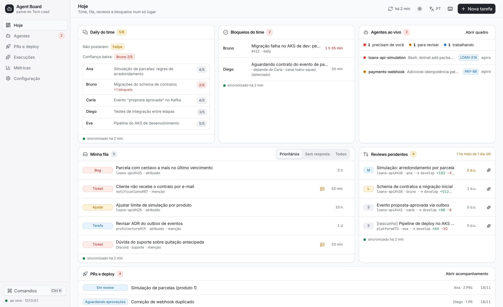

# Agent Board

[English](README.md) · **Português**

**Um painel local para Tech Leads.** Numa só tela: a daily do time, a sua fila, os reviews pendentes, o acompanhamento de PRs e deploys e os agentes do Claude Code e do Cursor que você roda em paralelo. Tudo roda só na sua máquina.



*Dados de exemplo. A interface existe em português e inglês (aperte `L` para trocar).*

---

## Sumário

1. [O que ele faz](#o-que-ele-faz)
2. [Como funciona](#como-funciona)
3. [Requisitos](#requisitos)
4. [Começo rápido](#começo-rápido)
5. [Conectando suas ferramentas](#conectando-suas-ferramentas)
6. [Sessões de agentes (hooks)](#sessões-de-agentes-hooks)
7. [Execuções em segundo plano](#execuções-em-segundo-plano)
8. [Configuração](#configuração)
9. [Privacidade e segurança](#privacidade-e-segurança)
10. [Idioma](#idioma)
11. [Desenvolvimento](#desenvolvimento)
12. [Problemas comuns](#problemas-comuns)
13. [Desinstalação](#desinstalação)

---

## O que ele faz

| Tela | O que você tem |
| --- | --- |
| **Hoje** | Daily do time (quem postou, confiança baixa, bloqueios novos), bloqueios do time com o tempo de cada um, sua fila (bugs, tickets, tarefas, menções sem resposta sua), reviews pendentes por tamanho e tempo de espera, PRs e deploy, agentes ao vivo e as últimas execuções |
| **Agentes** | Um card por sessão do Claude Code ou do Cursor, em colunas: *Precisa de você*, *Pronto para revisar*, *Trabalhando*, *Ociosas e encerradas*. Aprove pedidos de permissão, veja progresso, uso de contexto e custo, revise o diff e abra um PR em rascunho |
| **PRs e deploy** | Acompanhamento por issue. Os PRs ligados a cada issue são encontrados e atualizados sozinhos, de qualquer autor e repositório, com o status da fila de review até o merge e a data de deploy |
| **Execuções** | Reviews feitas pelo Claude em segundo plano, com log ao vivo, resultado (veredito, riscos, achados por arquivo e linha) e o prompt mascarado |
| **Métricas** | Tempo dos agentes trabalhando e esperando você, resposta mediana a pedidos, custo estimado, por dia e por tarefa |
| **Configuração** | Estado de cada integração, RAGs de features, limites de custo e preferências (idioma, tema, densidade, editor, notificações no desktop) |

Outros detalhes:

- Paleta de comandos (`Ctrl K`) e atalhos de teclado para todas as telas (`?` mostra a lista).
- Tema claro e escuro, densidade compacta ou confortável.
- Notificação no desktop quando um agente precisa de você ou fica pronto para revisar.
- Toda integração é opcional. Um bloco sem a integração dele diz o que falta e como configurar.

---

## Como funciona

```
Claude Code / Cursor ──hook──▶ hook.js ──▶ ~/.agent-board/sessions/*.json ──┐
                                                                           ▼
GitHub (GraphQL, polling) ─────────────────────────────▶  apps/server (Fastify, 127.0.0.1)  ──▶  apps/web (React)
Discord (bot só leitura, polling) ─────────────────────▶        │                                 no seu navegador
RAGs de features (clones git locais) ──────────────────▶        ├─▶ MongoDB: só as coleções painel_*
                                                                 └─▶ claude -p (execuções isoladas)
```

- **`hook.js`** roda a cada evento do agente e grava o estado da sessão num JSON pequeno. Ele nunca trava o agente.
- **`apps/server`** lê as sessões, consulta GitHub e Discord a cada poucos minutos, guarda os próprios dados no MongoDB e roda as reviews em segundo plano.
- **`apps/web`** é uma página única servida pelo servidor.

As decisões de arquitetura ficam em [`docs/adr/`](docs/adr/).

---

## Requisitos

| Requisito | Para quê | Como conferir |
| --- | --- | --- |
| Node.js 20.12 ou mais novo | Tudo | `node --version` |
| Claude Code e/ou Cursor | Sessões de agentes e execuções em segundo plano | `claude --version` |
| GitHub CLI, logado | Fila, reviews, PRs, PRs em rascunho | `gh auth status` |
| MongoDB | PRs e deploy, execuções, resumos | Um banco só do painel |
| Um bot do Discord (só leitura) | Daily, bloqueios, menções no Discord | Veja [Discord](#discord) |

---

## Começo rápido

```bash
git clone https://github.com/JandersonSR/agent-board.git
cd agent-board
npm install
cp .env.example .env      # preencha só o que usar; vazio = integração desligada
npm run install-hooks     # hooks do Claude Code (o Cursor está mais abaixo)
npm run build
npm start                 # http://localhost:9999
```

Os hooks apontam para o caminho absoluto desta pasta. Deixe o projeto num lugar fixo e rode `npm run install-hooks` de novo se mudar a pasta de lugar.

Para ver o painel sem sessões reais, rode `npm run demo` num segundo terminal. Quatro cards de exemplo aparecem em **Agentes**. Remova com `npm run demo -- --clear`.

---

## Conectando suas ferramentas

### GitHub

- Usa `GITHUB_TOKEN` ou, se estiver vazio, o token do `gh auth token`.
- Defina `GITHUB_ORG` e, para acompanhar os PRs do time, `TEAM_GITHUB_LOGINS`.
- A data de deploy vem de um campo do GitHub Project quando `GITHUB_PROJECTS` está definido e o token tem o escopo `read:project` (`gh auth refresh -s read:project`). Sem isso, você informa a data no painel.

### Discord

O painel lê o Discord por um bot privado com permissões **só de leitura**. Ele nunca envia mensagens.

1. Discord Developer Portal → **New Application**.
2. Aba **Bot**: **Reset Token** → `DISCORD_BOT_TOKEN`. Ative **Message Content Intent** e desative **Public Bot**.
3. **OAuth2 → URL Generator**: scope `bot`, permissões **só** *View Channels* e *Read Message History*.
4. Um admin do servidor abre a URL e adiciona o bot.
5. Com o Modo desenvolvedor ligado, copie os IDs do servidor, dos canais e do seu usuário para o `.env` (`DISCORD_GUILD_ID`, `DISCORD_DAILY_CHANNEL_ID`, `DISCORD_WATCH_CHANNELS`, `DISCORD_MY_USER_ID`, `TEAM_DISCORD_MEMBERS`).

### MongoDB

O painel só escreve nas próprias coleções, `painel_resumos`, `painel_sessoes` e `painel_prs`, e o código impõe isso com uma lista permitida. Use um banco e um usuário só do painel (`MONGO_URI` ou `MONGO_DATABASE_*`). O painel sobe sem MongoDB; os blocos que dependem dele avisam.

### RAGs de features e skills

As reviews em segundo plano podem usar um ou mais mapas de features (clones git com `AGENTS.md` e `packs/_index.yaml`) e a skill de review do kit do time. Defina `FEAT_MAPS`, `FEAT_MAP_ROUTES`, `SKILLS_KIT_PATH` e `SKILL_NAMES`. **Configuração** mostra o estado de cada mapa e permite testar a busca.

---

## Sessões de agentes (hooks)

```bash
npm run install-hooks     # Claude Code: ~/.claude/settings.json
npm run install-cursor    # Cursor: ~/.cursor/hooks.json
```

O instalador faz backup do seu arquivo (`.bak-agent-board`), mantém os seus outros hooks e nunca duplica. Reinicie as sessões abertas para elas carregarem os hooks.

Na tela **Agentes**:

| Coluna | O card vai para cá quando… |
| --- | --- |
| Precisa de você | O agente pediu permissão ou está esperando uma resposta |
| Pronto para revisar | O agente terminou o turno |
| Trabalhando | Você mandou um prompt ou o agente está usando ferramentas |
| Ociosas e encerradas | A sessão ainda não tem prompt, ou foi fechada |

- **Aprovações:** pedidos de permissão mostram o comando exato com **Permitir** e **Negar**. O hook espera o painel só enquanto ele está aberto numa aba, por até `AGENT_BOARD_APPROVAL_WAIT` segundos (padrão 120). Fora disso, o terminal pergunta normalmente. O Cursor não tem evento equivalente, então os cards do Cursor não têm botões de aprovação.
- **Mudanças:** diff contra a branch base, arquivo por arquivo, status do PR e do CI, e **Criar PR rascunho** (com confirmação e nunca a partir de `main`, `master`, `develop` ou `production*`).
- **Nova tarefa** (`N`): cria um worktree do git e abre o Claude Code ou o Cursor nele.
- **Por tarefa:** agrupa sessões pelo ID da tarefa (`FEAT-123`) encontrado na branch ou no primeiro prompt.
- **Push no celular (opcional):** defina `AGENT_BOARD_NTFY` com um tópico do [ntfy](https://ntfy.sh). O push leva só a pasta, a branch e o estado. Quem souber o nome do tópico consegue ler, então use um nome difícil de adivinhar ou um servidor próprio.

---

## Execuções em segundo plano

O botão ✨ num review pendente pede ao Claude que revise o PR em segundo plano:

1. Você vê antes o prompt completo (skill de review + features relevantes dos RAGs), já mascarado, e pode editar.
2. O Claude roda com `claude -p`, isolado das suas configurações globais e **só com leitura**: ele lê o PR e o mapa de features, e não consegue comentar, aprovar, fazer push nem navegar na web.
3. O resultado (veredito, riscos, achados por arquivo e linha) aparece em **Execuções**.
4. **Criar review PENDING** transforma os achados numa review pendente no seu nome. Só você pode submetê-la no GitHub. Nada é aprovado automaticamente.

Limites: `MAX_CONCURRENT_SESSIONS`, `SESSION_TIMEOUT_MIN` e `MAX_DAILY_RUNS`. A `ANTHROPIC_API_KEY` é removida do ambiente da execução, para nunca cobrar a API por engano.

---

## Configuração

Toda a configuração fica no `.env`. O [`.env.example`](.env.example) lista cada variável com um comentário. Vazio significa desligado.

| Grupo | Principais variáveis |
| --- | --- |
| Servidor | `AGENT_BOARD_PORT` (padrão 9999), `AGENT_BOARD_DIR`, `AGENT_BOARD_APPROVAL_WAIT`, `AGENT_BOARD_TASK_RE`, `AGENT_BOARD_NTFY` |
| MongoDB | `MONGO_URI` ou `MONGO_DATABASE_NAME/USER/PASS/CLUSTERNAME` |
| GitHub | `GITHUB_TOKEN`, `GITHUB_ORG`, `GITHUB_LOGIN`, `TEAM_GITHUB_LOGINS`, `GITHUB_PROJECTS`, `DEPLOY_*` |
| Discord | `DISCORD_BOT_TOKEN`, `DISCORD_GUILD_ID`, `DISCORD_DAILY_CHANNEL_ID`, `DISCORD_WATCH_CHANNELS`, `DISCORD_MY_USER_ID`, `TEAM_DISCORD_MEMBERS` |
| Time e fila | `TEAM_TZ_OFFSET_MIN`, `HOLIDAYS`, `QUEUE_TYPE_ORDER` |
| Contexto dos agentes | `FEAT_MAPS`, `FEAT_MAP_ROUTES`, `FEAT_CONTEXT_TOKENS`, `SKILLS_KIT_PATH`, `SKILL_NAMES`, `REPOS`, `WORKTREES_DIR`, `AGENT_MODEL_*` |
| Limites de custo | `MAX_CONCURRENT_SESSIONS`, `SESSION_TIMEOUT_MIN`, `MAX_DAILY_RUNS`, `POLL_INTERVAL_MIN` |
| Privacidade | `MASK_EXTRA_PATTERNS` |

Variáveis de ambiente reais têm prioridade sobre o `.env`. Reinicie o servidor depois de mudar.

---

## Privacidade e segurança

- O servidor escuta **só em 127.0.0.1**. Isso não é configurável.
- Ele confere o cabeçalho `Host` (contra DNS rebinding). Toda escrita exige o cabeçalho `X-Agent-Board` e um `Origin` local, então nenhum site aberto no navegador consegue aprovar ferramentas, iniciar agentes ou abrir PRs.
- **Dados pessoais são mascarados** (CPF, CNPJ, e-mails, telefones, cartões, dados bancários, renda, tokens) antes de qualquer texto ir para o modelo, para o banco ou para uma mensagem de erro. Padrões extras vão em `MASK_EXTRA_PATTERNS`.
- O Discord é lido por um **bot só de leitura**. O painel nunca envia mensagens no Discord.
- As escritas no MongoDB ficam restritas às coleções do painel. Nenhum índice é criado em outras coleções.
- Nada é postado no GitHub sem o seu clique: PR em rascunho e review pendente sempre pedem confirmação.
- Os segredos ficam só no `.env`, que é ignorado pelo git. Nunca aparecem na tela nem nos logs.
- Antes de usar no trabalho, confirme que a empresa permite as ferramentas de IA e as integrações que você ligar.

---

## Idioma

A interface existe em **português (Brasil)** e **inglês**. Na primeira visita, ela segue o idioma do navegador. Troque quando quiser pelo botão **PT/EN** no topo, pelo atalho `L` ou em **Configuração → Idioma**.

Textos escritos por pessoas e ferramentas (títulos de issues, mensagens da daily, respostas dos agentes) ficam no idioma original.

---

## Desenvolvimento

```bash
npm run dev          # API (tsx watch) + web (Vite, http://127.0.0.1:5173)
npm test             # hooks (node --test) + servidor + web (Vitest)
npm run typecheck
npm run build && npm start
```

```
agent-board/
├── apps/
│   ├── server/        # Fastify + Zod: rotas, sincronização GitHub/Discord, MongoDB, execuções, mascaramento
│   └── web/           # React + Vite + Tailwind + shadcn/ui
├── hook.js            # Hook dos agentes (JavaScript puro, sem dependências, inicia em milissegundos)
├── install.js         # Instala/remove os hooks do Claude Code ou do Cursor
├── demo.js            # Sessões de exemplo
├── lib/               # Bibliotecas do hook: estado da sessão, uso do transcript, preços
├── docs/adr/          # Registros de decisões de arquitetura
└── .env.example
```

**Texto novo na interface:** escreva o texto em português dentro de `t('…')` (ou `k('…')` em constantes) e adicione a versão em inglês em `apps/web/src/lib/i18n-en.ts`. Um teste falha se algum texto ficar sem tradução ou se as `{variáveis}` forem diferentes.

O servidor anterior, de arquivo único, continua disponível como `npm run start:legacy` até ser removido.

---

## Problemas comuns

| Problema | O que fazer |
| --- | --- |
| Nenhum card para uma sessão real | Reinicie a sessão. Confira `/hooks` dentro do Claude Code e se `~/.agent-board/sessions` recebe um JSON por sessão. Se mudou a pasta de lugar, rode `npm run install-hooks` de novo |
| Um bloco diz "não configurado" | Preencha no `.env` as variáveis que ele cita e reinicie. **Configuração** mostra o que falta |
| `EADDRINUSE` ao iniciar | A porta 9999 está em uso. Defina `AGENT_BOARD_PORT` |
| Card preso na coluna errada | Uma sessão que travou pode nunca mandar o último evento. **Dispense** o card; o próximo evento o recria |
| Datas do Project não aparecem | O token não tem `read:project`. Rode `gh auth refresh -s read:project` e defina `GITHUB_PROJECTS` |
| Instalador diz "JSON inválido" | Corrija o `settings.json`/`hooks.json` ou restaure o backup `.bak-agent-board` e instale de novo |

---

## Desinstalação

```bash
npm run uninstall-hooks     # Claude Code
npm run uninstall-cursor    # Cursor
```

Só os hooks do painel são removidos. Depois apague a pasta do projeto e, se quiser, `~/.agent-board`.

## Licença

MIT
